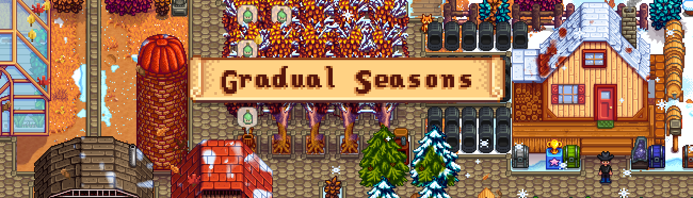
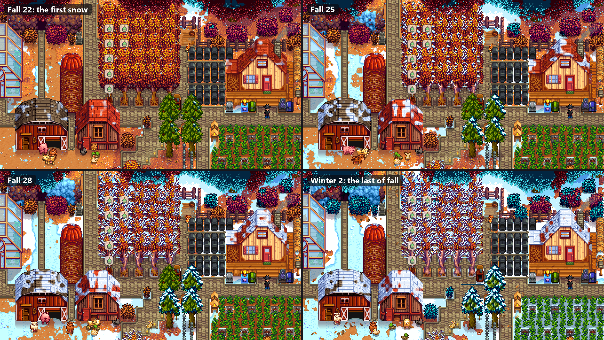
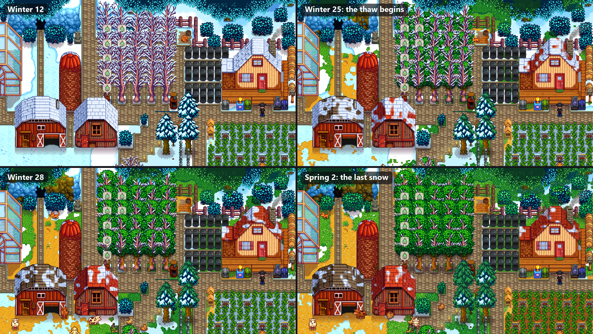
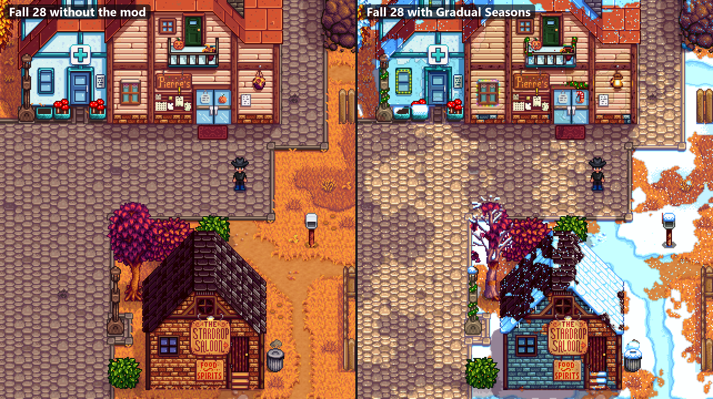

# Gradual Seasons

**A Stardew Valley 1.6 mod (SMAPI) that blends the seasons into each other.**

In vanilla Stardew Valley the whole valley flips to the next season overnight on day 1. With Gradual Seasons the
next season creeps in during the last week of the old one, and a little of the old season lingers into the new one.
Snow settles on the map, the trees and the roofs bit by bit through late fall. Fall colours spread through late
summer. In late winter the thaw shows spring grass through the snow, and the weather follows along.

- **Download:** [Nexus Mods](https://www.nexusmods.com/stardewvalley/mods/55595)
- **Requires:** Stardew Valley 1.6 and [SMAPI](https://smapi.io) 4.0 or later
- **Optional:** [Generic Mod Config Menu](https://www.nexusmods.com/stardewvalley/mods/5098), for an in-game settings page



## What it does

- **The map changes gradually.** The game's own next-season tiles (snowy ground, icy pond banks, frosted cliffs,
  snowy town roofs, bare map trees, spring grass...) appear in natural, soft-edged patches that grow every day.
  Ponds and rivers slowly take on their next-season colour. By fall 28 most of the map already looks like winter,
  so winter 1 isn't a sudden white map, and the snow melts away the same way in early spring.
- **Trees and buildings change too.** Wild trees turn orange and red through late summer, thin out and catch snow
  through late fall, and bud through late winter. Snow builds up on the farmhouse and farm building roofs in late
  fall and melts in early spring.
- **Falling particles.** Snow flurries, sleet, falling leaves and cherry petals, more each day, following each
  area's own weather.
- **The weather follows (host only).** Rainy days near winter can turn into snow days, storms calm down as fall
  arrives, and the thaw brings rain. The forecast is changed the same way the vanilla Rain Totem does it, so the
  TV forecast stays right and multiplayer stays in sync.
- **Nothing on disk changes.** Everything is drawn on top of the map or edited in memory through SMAPI's content
  API. Turn an option off, or remove the mod, and everything goes back to normal. No Harmony, no reflection.



## Compatibility

- **Expansions and map mods** (Stardew Valley Expanded, Ridgeside Village, Sunberry Village, East Scarp, custom
  farms...): their maps change gradually too, as long as their tile sheets come in seasonal versions
  (`spring_...`, `winter_...`), which is how the game itself swaps them on day 1.
- **Seasons of Stardew:** detected automatically. The next season only creeps in at the end of the third month.
- **Recolours** that cover every season change gradually in their own colours.
- **Retextures that only change the current season** (Content Patcher's `{{season}}` token, like a seasonal
  special order board or **Way Back Pelican Town**): their art is kept exactly as it is until day 1 instead of
  being painted over with the plain game's art, even with a recolour installed too. The ground around it still
  changes gradually.
- **Elle's Seasonal Vanilla Buildings** and SVE's winter snow on buildings melt and settle gradually like the
  game's own snow.
- **Multiplayer:** every player who wants to see the effects needs the mod; only the host's copy changes the
  weather.



## Settings

Edit `Mods/GradualSeasons/config.json` (created the first time you start the game), or use Generic Mod Config Menu.

| Setting | Default | What it does |
|---|---|---|
| `EnableWeatherChanges` | `true` | Let transitions change tomorrow's forecast (host only). |
| `EnableParticles` | `true` | Draw the snow, sleet, leaf and petal particles. |
| `EnableMapChanges` | `true` | Turn the map into the next season gradually, plus fallen leaves, petals and flowers. |
| `EnableTreeAndBuildingChanges` | `true` | Blend trees (and buildings with their own seasonal look) toward the next season. |
| `EnableRoofSnow` | `true` | Snow on the farmhouse and farm building roofs in late fall and winter. |
| `RampDays` | `7` | Days at the end of each season when the next one creeps in (0–14). |
| `LingerDays` | `3` | Days at the start of each season when the old one lingers (0–7). |
| `Strength` | `1.0` | Multiplies every chance, particle count and how fast things change (0–2). |
| `MaxParticles` | `150` | Most particles of one kind on screen. |
| `ShowDuringFestivals` | `false` | Also show particles and map changes during festivals. |
| `DebugLogging` | `false` | Show each weather decision in the SMAPI console. |

### Console commands

Type these in the SMAPI console while a save is loaded:

- `gs_status`: the date, today's and tomorrow's transition intensity, tomorrow's forecast, and what the mod changed.
- `gs_preview <season> <day>` (for example `gs_preview fall 26`): preview another date's particles and map change
  without changing the date. `gs_preview off` stops it.

SMAPI's own `world_setseason` and `world_setday` commands work too: the map, trees and buildings follow the new
date within a second.

## How it works

The code is in [`GradualSeasons/`](GradualSeasons). The main ideas:

| File | What it does |
|---|---|
| `ModEntry.cs` | Entry point: hooks SMAPI's events, the console commands and the config menu. |
| `TransitionSchedule.cs` | Works out how far into a transition any date is (and reads Seasons of Stardew's months). |
| `WeatherNudger.cs` | Host only: may change tomorrow's forecast, using a chance table seeded from the save and the day. |
| `ParticleLayer.cs` | Draws the falling snow, sleet, leaves and petals. |
| `SeasonTileLayer.cs` | The map change. For every map tile it draws the other season's version of that tile, but only where a smooth noise pattern says that spot has turned. The pattern is computed per pixel across the whole map, so the patches have natural edges that don't follow the tile grid, and every map layer turns together. |
| `VanillaArt.cs` | Reads the game's own images straight from its Content folder and compares them with the images the game is actually using, to find art that another mod changed for the current season only. That art is kept until day 1 instead of being painted over (see below). |
| `GroundLayer.cs` | Fallen leaves, fallen petals and summer wildflowers. |
| `TextureBlender.cs` | Blends tree and building textures toward the next season in leaf-sized clumps (in memory, through SMAPI's content API). |
| `RoofSnow.cs` | Snow on farm building roofs, using the game's paint masks to find exactly which pixels are roof. |
| `SpriteFactory.cs` | The mod's own pixel art (particles, flowers) as text grids, plus loading the PNGs. |
| `IGenericModConfigMenuApi.cs` | The optional Generic Mod Config Menu API. |

**Keeping other mods' art intact.** Some mods only change the current season's tile sheets. When the mod blends
in the next season's sheet, that sheet doesn't have their art yet. `VanillaArt.cs` finds that art in three steps:

1. **Pixels a mod changed this season but not in the other season.** Each season's sheet is compared with the
   game's own copy.
2. **Tiles a mod redrew.** A recolour gives every pixel of one of the game's colours the same new colour, whatever
   its palette. Redrawn art doesn't follow the game's art at all. So each 16×16 tile is checked for whether it is
   still "a colour swap of the game's tile". This works even when a recolour has changed every season's sheet. A
   tile only counts if no other season's version of it is redrawn too, so a recolour painted by hand (with its
   own shading in every season) isn't mistaken for one.
3. **Holes.** Tiles closed in by kept tiles (like a flat snowy part of a redrawn roof) are kept too, so the game's
   own version of a building never shows through it.

Snow and ice that mods add to the winter sheets for good (like Elle's frozen fountain) are recognised and still
melt gradually.

## Building from source

You need:

- Stardew Valley 1.6 with [SMAPI](https://smapi.io) installed.
- The [.NET 6 SDK](https://dotnet.microsoft.com/download/dotnet/6.0) (newer SDKs work too; the project targets
  .NET 6 like the game).

Then, in this folder:

```
dotnet build
```

The build uses [Pathoschild.Stardew.ModBuildConfig](https://www.nuget.org/packages/Pathoschild.Stardew.ModBuildConfig),
which finds your game folder, references the game's DLLs and copies the finished mod into your `Mods` folder.
`dotnet build -c Release` also makes a ready-to-share zip in a `release` folder here.

If your game isn't in a standard Steam or GOG folder, set its path in `GradualSeasons/GradualSeasons.csproj`
(the `<GamePath>` property), or see
[ModBuildConfig's docs](https://github.com/Pathoschild/SMAPI/blob/develop/docs/technical/mod-package.md) for other
ways.

The mod's own pixel art lives in `GradualSeasons/SpriteFactory.cs` as text grids.
`python tools/generate_sprites.py` turns those grids into `GradualSeasons/assets/*.png` and
`preview/particles_preview.png` (it needs Pillow: `python -m pip install pillow`).

### Project layout

```
GradualSeasons.sln               solution (open in Visual Studio or Rider, or just use dotnet build)
GradualSeasons/                  the mod
├── GradualSeasons.csproj
├── manifest.json                SMAPI manifest
├── *.cs                         the code (see "How it works")
└── assets/                      particles.png, ground.png
tools/generate_sprites.py        rebuilds the PNGs from SpriteFactory.cs
preview/particles_preview.png    enlarged preview of the sprites
docs/images/                     screenshots for this page
CHANGELOG.md                     what changed in each version
```

## Bug reports and ideas

Please report bugs on the [Nexus page](https://www.nexusmods.com/stardewvalley/mods/55595) (Posts or Bugs tab),
or open an issue here. A screenshot and your SMAPI log ([smapi.io/log](https://smapi.io/log)) help a lot. If you
spot a mod that doesn't play nicely with this one, tell me which one!

Pull requests are welcome too.

## License and credits

The code is released under the [MIT License](LICENSE).

- Stardew Valley is by ConcernedApe. The snowy ground, roofs and other seasonal tiles you see during a transition
  are the game's own art (or your installed mods'), read from the game at runtime. None of it is included here.
- [SMAPI](https://smapi.io) and ModBuildConfig are by Pathoschild.
- `IGenericModConfigMenuApi.cs` is the API interface published by
  [Generic Mod Config Menu](https://github.com/spacechase0/StardewValleyMods) (spacechase0), for mods to copy.

---

### A note from me

I'm a novice coder, and I couldn't have made this on my own. I built Gradual Seasons with a lot of help from an AI
(Claude, by Anthropic). I came up with the idea and tested it in my own game, and the AI helped me write, understand
and debug the code. If something in here looks odd, that's probably why! Feel free to open an issue or suggest a
fix, and please be kind. Thanks for playing!
